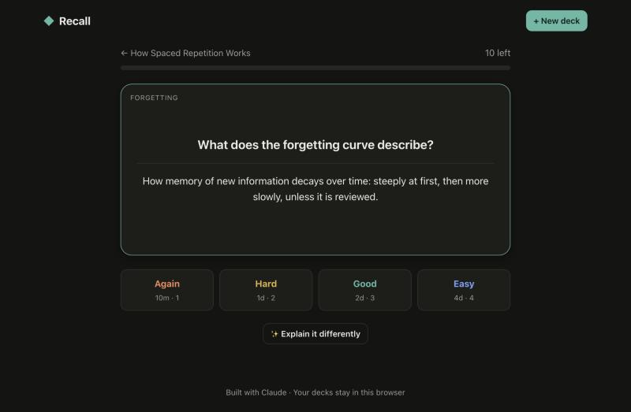
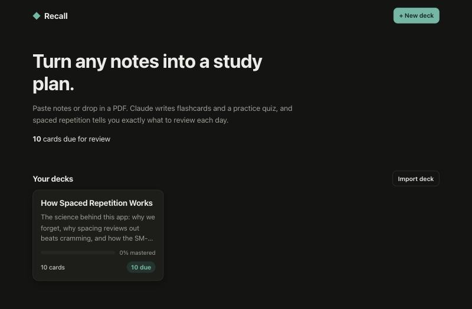

# Recall: an AI study buddy

Recall turns your notes and PDFs into flashcards and a practice quiz using Claude, then uses spaced repetition so you review each card right before you'd forget it.



## What it does

- **Notes or PDFs in, deck out.** Paste notes, drop in a text file, or upload a PDF of up to 20 MB (lecture slides, a textbook chapter). Claude writes one-idea-per-card flashcards grouped by topic, plus a multiple-choice quiz with explanations.
- **Spaced repetition.** Each card is scheduled with an SM-2-style algorithm and four answer buttons (Again, Hard, Good, Easy). Each button shows when you'd see the card next, and you can answer with keys 1–4.
- **Quizzes feed your reviews.** If you miss a quiz question, the cards on that topic go back into your review queue.
- **"Explain it differently".** Stuck on a card? Claude explains it again with an analogy or a memory hook.
- **Private by default.** Decks are stored in your browser. You can export a deck to JSON and import it again.
- **Works without a key.** A built-in sample deck lets you try studying and quizzing before you set up an API key.



## Getting started

You need Node.js 22 or newer and an [Anthropic API key](https://console.anthropic.com/).

```bash
git clone https://github.com/Fady120/recall-study-buddy.git
cd recall-study-buddy
npm install
cp .env.example .env   # then put your key in .env
npm run dev
```

Open http://localhost:5173.

| Script | What it does |
| --- | --- |
| `npm run dev` | Runs the API (port 8787) and the Vite dev server (port 5173) with hot reload |
| `npm test` | Runs the unit and API tests (Vitest) |
| `npm run typecheck` | Type-checks the whole project |
| `npm run build` then `npm start` | Builds the front end; the Node server then serves the app and the API on one port (`PORT`, default 8787) |

## How it works

```
Browser (React)                      Node server (Express)              Claude API
───────────────                      ─────────────────────              ──────────
NewDeck  ── notes / PDF (base64) ──▶ POST /api/generate ──────────────▶ structured JSON output
Study    ── card ──────────────────▶ POST /api/explain  ──────────────▶ short explanation
localStorage ◀── decks, review schedule (srs.ts)
```

- **The API key stays on the server.** The browser only talks to `/api`, and the server calls Claude with the official [`@anthropic-ai/sdk`](https://github.com/anthropics/anthropic-sdk-typescript).
- **Structured outputs.** Deck generation sends a JSON Schema in `output_config.format`, so Claude's reply is always parseable JSON. The server still checks it with Zod (for example, that each quiz answer points at a real choice) before returning it.
- **PDFs are read by Claude directly.** They're sent as `document` content blocks, so Claude sees tables and layout as well as the text.
- **Effort is matched to the task.** Deck generation runs at `medium` effort and quick explanations at `low`. Refusals, truncated output and API errors become plain-language messages in the UI.
- **Server-side fallback** (`fallbacks: "default"`) is turned on, so if a safety classifier declines a request, it is retried on a recommended model.

### Project layout

```
server/        Express API and the Claude integration (claude.ts)
shared/        Zod schemas + JSON Schema shared by server and client
src/lib/       Spaced-repetition scheduler, deck logic, storage, API client
src/components Library, NewDeck, DeckView, Study, Quiz
tests/         Vitest tests for the scheduler, deck logic, API routes and Claude client
```

## Configuration

| Variable | Default | Purpose |
| --- | --- | --- |
| `ANTHROPIC_API_KEY` | (none) | Your Anthropic API key (required to generate decks) |
| `RECALL_MODEL` | `claude-opus-5-5` | Claude model to use |
| `PORT` | `8787` | Port for the production server |

## Roadmap

- [ ] Edit cards and add your own by hand
- [ ] Image occlusion cards from diagrams in PDFs
- [ ] Sync decks across devices
- [ ] Study streaks and a review heatmap
- [ ] Export to Anki

## Built with Claude Code

This project is being built with [Claude Code](https://claude.com/claude-code) as an AI pair programmer.

## License

[MIT](LICENSE)
